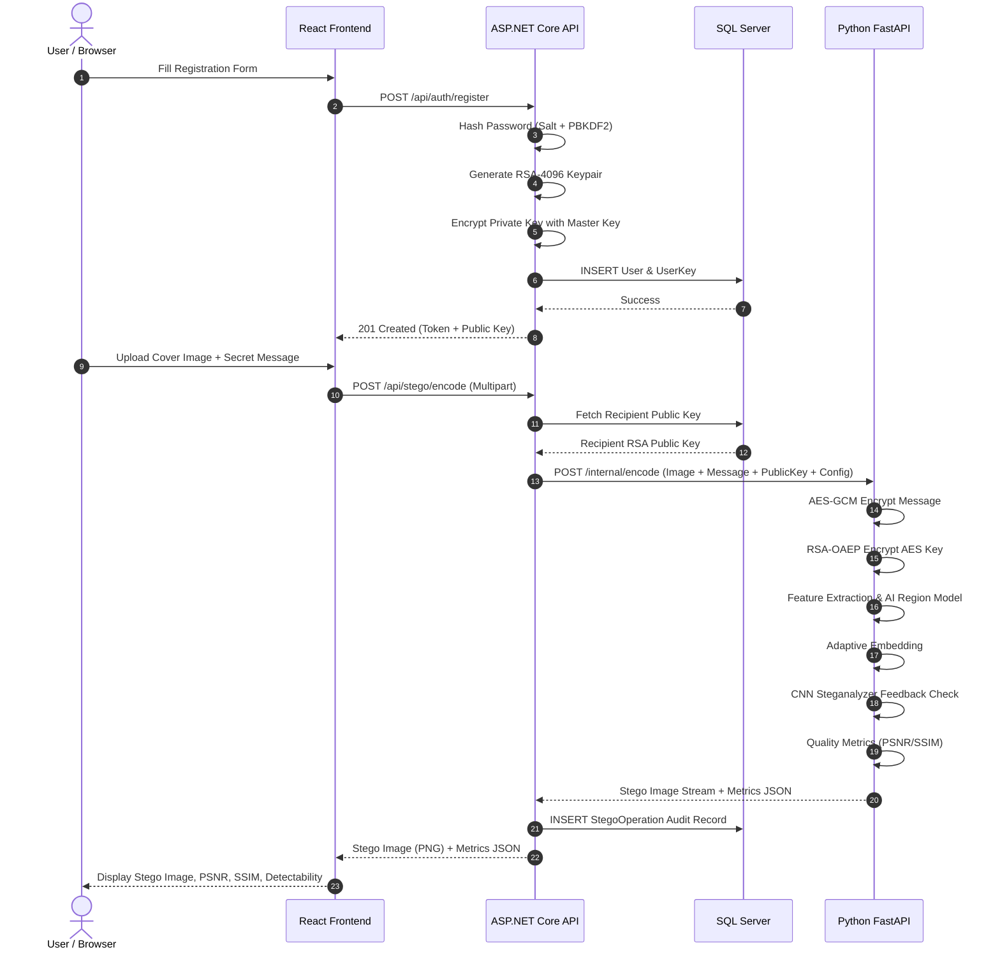
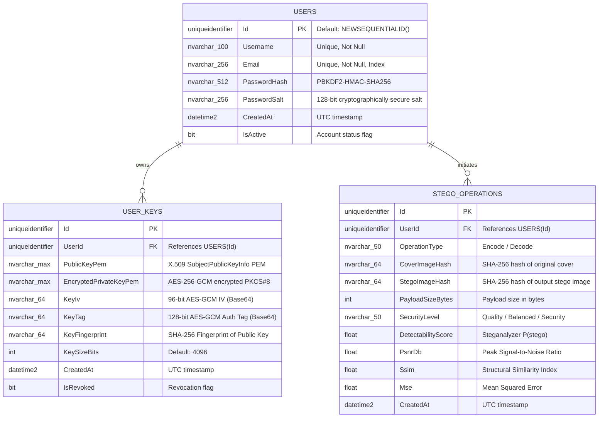
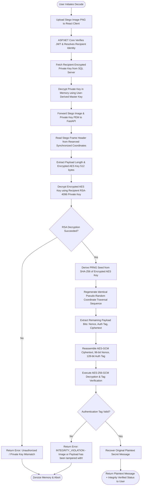

# AI-Based Adaptive Steganography System with Automated Key Generation
## Comprehensive Architectural Specification (Phase 0)

---

## 1. Executive Summary & Architectural Overview

The **AI-Based Adaptive Steganography System with Automated Key Generation** is an enterprise-grade, research-oriented steganographic framework. Traditional Least Significant Bit (LSB) steganography embeds secret data sequentially or uniformly across all pixels, creating obvious statistical anomalies (such as Chi-Square irregularities and histogram peaks) that trivial steganalysis tools easily detect.

This project introduces a multi-tier defense-in-depth architecture:
1. **Hybrid Cryptographic Layer**: Encrypts secret messages using **AES-256-GCM** (ensuring confidentiality and tamper detection via 128-bit authentication tags), while securing symmetric AES keys using **RSA-4096-OAEP** public-key cryptography.
2. **Automated Cryptographic Key Lifecycle**: Secure, automated generation and storage of RSA key pairs within an **ASP.NET Core** backend and **SQL Server** database, with private keys encrypted at rest using an AES-256 key derived from user credentials (PBKDF2/HMAC-SHA256).
3. **AI-Driven Image Region Selection**: Extracts image complexity features (Shannon entropy, local variance, Sobel gradient magnitude, Canny edge density, Haralick texture) and feeds them into a trained **Random Forest** model to classify and rank image blocks based on embedding suitability.
4. **Dynamic Adaptive Embedding**: Adjusts embedding depth (1 to 3 bits per channel) based on region complexity, using a cryptographically secure pseudo-random number generator (CSPRNG) seeded by a shared secret (HKDF-derived) to scatter payload bits across chosen blocks.
5. **AI Steganalysis Feedback Loop**: Evaluates the stego image using a trained **PyTorch CNN Steganalyzer**. If the detectability probability exceeds a defined threshold, an iterative optimization loop adjusts region selection and embedding intensity to minimize detectability while maintaining high visual fidelity (PSNR > 40 dB, SSIM > 0.98).

```
+-----------------------------------------------------------------------------------+
|                                  USER / CLIENT                                    |
|             React.js Single Page Application (Vite + Axios + Clean UI)            |
+-----------------------------------------------------------------------------------+
                                          |
                         HTTPS / REST / JWT Bearer Tokens
                         Multipart Form-Data (Images/Data)
                                          v
+-----------------------------------------------------------------------------------+
|                          ASP.NET CORE 10.0 WEB API                                |
|  - JWT Authentication & Authorization (Roles & Policies)                          |
|  - User Management & Key Vault Service (AES-256-KW / PBKDF2)                      |
|  - Automated RSA Key Pair Generator (RSA-4096)                                    |
|  - Reverse-Proxy Orchestration / FastAPI Gateway Client                           |
|  - Audit Logging & Experiment Metadata Storage                                    |
+-----------------------------------------------------------------------------------+
             |                                                  |
             | Entity Framework Core                            | Internal HTTP Client
             | Parameterized SQL Queries                        | JSON / Multipart Streams
             v                                                  v
+-----------------------------+     +-----------------------------------------------+
|     MICROSOFT SQL SERVER    |     |             PYTHON 3.11+ FASTAPI              |
|  - Users (Credentials)      |     |             AI & STEGANOGRAPHY ENGINE         |
|  - UserKeys (Encrypted PEM) |     |  - AES-256-GCM / RSA-OAEP Hybrid Crypto Engine|
|  - StegoOperations (Audit)  |     |  - Spatial Feature Extractor (Entropy/Edges)  |
|  - Experiments (Benchmarking|     |  - AI Region Suitability Model (Random Forest)|
+-----------------------------+     |  - Adaptive Dynamic LSB Embedder & Extractor  |
                                    |  - AI Steganalyzer Model (PyTorch CNN)        |
                                    |  - Multi-Objective Feedback Optimizer         |
                                    |  - Quality Evaluator (PSNR, SSIM, MSE, BER)   |
                                    +-----------------------------------------------+
```

---

## 2. Component Breakdown & Responsibilities

### 2.1. React.js Frontend
* **Technology**: React 18/19, JavaScript (ES6+), Vanilla CSS (Custom Design System, Glassmorphic / Dark Slate styling, CSS variables), Axios.
* **Responsibilities**:
  * **Authentication Views**: User Registration, Login, JWT session management (storage in secure HTTP-only cookies or memory + refresh tokens).
  * **Key Management Dashboard**: View public key fingerprint, regenerate RSA key pairs, export public key, inspect key creation timestamps.
  * **Interactive Encode Workspace**:
    * Cover image upload with drag-and-drop.
    * Secret text/binary input with real-time **Dynamic Capacity Meter** (calculating maximum payload bytes at 1 bpp vs. adaptive bpp).
    * Optimization mode selector: *Quality Priority*, *Balanced*, or *Security Priority*.
    * Live progress tracker: Feature analysis -> Region masking -> Embedding -> Steganalyzer inspection -> Optimization iteration.
    * Stego image preview with visual comparison slider and download button.
    * Quality score display: PSNR, SSIM, MSE, AI Detectability probability.
  * **Interactive Decode Workspace**:
    * Stego image upload.
    * Automatic recipient private key resolution.
    * Payload extraction, integrity verification banner (Tamper detected vs. Verified authentic), and plaintext message viewer.
  * **Image Analysis & AI Steganalyzer Playground**:
    * Upload any image to view its entropy map, edge density heatmap, and AI detectability score.
  * **Research & Benchmark Hub**:
    * View side-by-side performance comparison tables (Traditional LSB vs. Adaptive Rule vs. AI Region vs. AI + Feedback).
    * Interactive charts (PSNR vs. Payload, ROC Curves, Loss curves).

### 2.2. ASP.NET Core Web API (BFF & Orchestrator)
* **Technology**: ASP.NET Core (C# 13 / .NET 10), Entity Framework Core, Microsoft.AspNetCore.Authentication.JwtBearer.
* **Responsibilities**:
  * **Gateway / Backend-for-Frontend (BFF)**: Protects the Python engine from direct external exposure. All client requests route through ASP.NET Core.
  * **Identity & Access Management**: Secure password hashing with salt, JWT token generation with standard claims (`sub`, `email`, `role`, `jti`).
  * **Automated RSA Key Generation**: On user registration or request, generates cryptographically sound RSA 4096-bit key pairs.
  * **Key Vaulting & At-Rest Protection**:
    * Public key is stored in PEM format.
    * Private key is encrypted using AES-256-CBC/GCM with a Master Key derived from the user's password using PBKDF2 (100,000 iterations + salt). Plaintext private keys are **never** persisted to the database.
  * **FastAPI Orchestration**: Proxies encode/decode requests to the Python engine, attaching cryptographic key headers and handling error cascades, timeouts, and payload limits.
  * **Audit & History Log**: Persists operational metadata (image dimensions, payload size, PSNR, SSIM, detectability score, timestamp) for user history and experiment tracking.

### 2.3. SQL Server Database
* **Technology**: Microsoft SQL Server 2022 / 2025 LocalDB.
* **Responsibilities**:
  * Persistent storage for user credentials, encrypted key vaults, operation history, and experimental metrics.
  * Strict relational constraints, primary keys, foreign keys, and indexes for fast lookup.

### 2.4. Python FastAPI Engine (AI & Steganography Core)
* **Technology**: Python 3.11+, FastAPI, Uvicorn, NumPy, OpenCV (cv2), Pillow, PyTorch, Scikit-Learn, Cryptography (PyCryptodome / cryptography library).
* **Responsibilities**:
  * **Cryptographic Engine**:
    * AES-256-GCM symmetric encryption (random 96-bit IV, 128-bit authentication tag).
    * RSA-4096-OAEP asymmetric key encapsulation using SHA-256.
  * **Image Feature Extractor**:
    * Splits cover images into $N \times N$ non-overlapping blocks (e.g., $16 \times 16$ or $32 \times 32$).
    * Calculates Shannon entropy, variance, Sobel gradient magnitude, Canny edge density, and color variance per block.
  * **AI Region Suitability Model**:
    * Pre-trained Scikit-Learn Random Forest Classifier that predicts block suitability (Smooth = 0, Medium = 1, High Texture/Edge = 2).
    * Sorts blocks by embedding capacity and perceptual tolerance.
  * **Dynamic & PRNG Embedder**:
    * Computes dynamic bit depth: High texture = 2–3 bits/channel, Medium = 1–2 bits, Smooth = 0–1 bit.
    * Uses a cryptographically derived PRNG seed to shuffle block traversal and pixel ordering, preventing sequential pattern analysis.
  * **AI Steganalyzer Model**:
    * PyTorch CNN trained on spatial rich residuals to output $P(\text{stego})$.
  * **Feedback Loop Optimizer**:
    * Executes an optimization loop: if $P(\text{stego}) > \tau_{\text{threshold}}$, decreases embedding strength in sensitive blocks, re-embeds, and re-evaluates until equilibrium or max iterations ($k_{\max} = 5$) is reached.
  * **Metric Evaluator**:
    * Calculates MSE, PSNR ($>40$ dB target), SSIM ($>0.98$ target), and Bit Error Rate (BER).

---

## 3. Communication Architecture & Protocol Definitions

### 3.1. React $\leftrightarrow$ ASP.NET Core
* **Protocol**: HTTP/1.1 or HTTP/2 over TLS (HTTPS).
* **Format**:
  * JSON for authentication, metadata, key queries, and metric responses (`application/json`).
  * Multipart Form Data (`multipart/form-data`) for image uploads with secret payloads.
* **Security**:
  * Authorization Header: `Bearer <jwt_token>` for authenticated endpoints.
  * CORS: Restricted strictly to the frontend origin (e.g., `http://localhost:5173`).
  * Input validation: Strict file type sniffing (magic bytes: PNG only), file size capping (max 15 MB).

### 3.2. ASP.NET Core $\leftrightarrow$ SQL Server
* **Protocol**: TDS (Tabular Data Stream) over TCP.
* **Mechanism**: Entity Framework Core with DbContext pooling.
* **Security**:
  * Parameterized SQL queries preventing SQL injection.
  * Sensitive columns (`EncryptedPrivateKeyPem`) encrypted before insertion.

### 3.3. ASP.NET Core $\leftrightarrow$ Python FastAPI Engine
* **Protocol**: HTTP/1.1 over internal private network / localhost (`http://127.0.0.1:8000`).
* **Format**:
  * `multipart/form-data` for passing images, payload files, and RSA keys.
  * `application/json` for feature queries, capacity checks, and health endpoints.
* **Resilience**:
  * Configured `HttpClient` with retry policies (Polly), 60-second timeouts for AI inference, and structured error mapping (translating 500/503 from FastAPI into informative user messages).



---

## 4. Complete Directory & File Structure

```
AI-Steganography-System/
│
├── PROJECT_ARCHITECTURE.md                <-- [This Document] High-level Master Specification
├── README.md                              <-- Project Overview & Quick Start
│
├── frontend/                              <-- React.js Single Page Application
│   ├── index.html                         <-- Entry HTML template with modern fonts
│   ├── package.json                       <-- React, Axios, Lucide Icons, Vite
│   ├── vite.config.js                     <-- Vite server & proxy configuration
│   └── src/
│       ├── assets/                        <-- Static visual assets, brand icons
│       ├── components/                    <-- Reusable UI components
│       │   ├── Navbar.jsx                 <-- Top navigation bar with auth status
│       │   ├── Footer.jsx                 <-- Footer with viva/project credits
│       │   ├── ProtectedRoute.jsx         <-- JWT auth guard for private routes
│       │   ├── CapacityMeter.jsx          <-- Live visual payload/capacity gauge
│       │   ├── MetricCard.jsx             <-- Display card for PSNR, SSIM, MSE
│       │   ├── ImageSlider.jsx            <-- Before/After comparison slider
│       │   └── HeatmapViewer.jsx          <-- Visualizer for AI region suitability
│       ├── context/
│       │   └── AuthContext.jsx            <-- User state, token storage, login/logout
│       ├── pages/
│       │   ├── LoginPage.jsx              <-- User login form
│       │   ├── RegisterPage.jsx           <-- User registration form
│       │   ├── DashboardPage.jsx          <-- Main hub with stats & quick actions
│       │   ├── EncodePage.jsx             <-- Steganographic embedding interface
│       │   ├── DecodePage.jsx             <-- Payload extraction & verification interface
│       │   ├── AnalyzePage.jsx            <-- Standalone image feature & AI region inspector
│       │   ├── DetectPage.jsx             <-- Standalone CNN Steganalyzer inspector
│       │   ├── ExperimentsPage.jsx        <-- Benchmark comparisons & research charts
│       │   └── ProfilePage.jsx            <-- User cryptographic keys & session metadata
│       ├── services/
│       │   ├── api.js                     <-- Axios base instance with JWT interceptor
│       │   ├── authService.js             <-- Auth API calls
│       │   ├── stegoService.js            <-- Encode, decode, capacity API calls
│       │   └── experimentService.js       <-- Benchmarks & figures API calls
│       ├── styles/
│       │   ├── index.css                  <-- Global tokens, typography, CSS reset
│       │   └── components.css             <-- Modular styling for custom components
│       ├── App.jsx                        <-- App router & layout shell
│       └── main.jsx                       <-- DOM root mount
│
├── backend/                               <-- ASP.NET Core Web API (.NET 10.0 / C#)
│   ├── Backend.sln                        <-- Solution file
│   └── StegoApi/
│       ├── StegoApi.csproj                <-- Project file & NuGet packages
│       ├── Program.cs                     <-- Web host configuration, DI, middleware
│       ├── appsettings.json               <-- Connection strings, JWT secrets, FastAPI URI
│       ├── Controllers/
│       │   ├── AuthController.cs          <-- Register, Login, Profile endpoints
│       │   ├── KeysController.cs          <-- RSA Key generation, retrieval, public export
│       │   ├── StegoController.cs         <-- Gateway to encode, decode, capacity endpoints
│       │   ├── AnalysisController.cs      <-- Gateway to feature analysis & detection
│       │   └── ExperimentsController.cs   <-- Historical experiment data & benchmarks
│       ├── Data/
│       │   ├── ApplicationDbContext.cs    <-- EF Core DbContext with model configurations
│       │   └── Migrations/                <-- EF Core schema migration files
│       ├── Models/
│       │   ├── Entities/
│       │   │   ├── User.cs                <-- Application user entity
│       │   │   ├── UserKey.cs             <-- RSA public/private key vault entity
│       │   │   └── StegoOperation.cs      <-- Historical steganography operations
│       │   └── DTOs/
│       │       ├── AuthDtos.cs            <-- Login, Register, Token DTOs
│       │       ├── KeyDtos.cs             <-- Key export & fingerprint DTOs
│       │       └── StegoDtos.cs           <-- Encode request, Decode request, Metrics DTOs
│       ├── Services/
│       │   ├── Interfaces/
│       │   │   ├── IAuthService.cs        <-- Authentication service contract
│       │   │   ├── IKeyVaultService.cs    <-- Key generation & vaulting contract
│       │   │   └── IFastApiClient.cs      <-- Python FastAPI HTTP bridge contract
│       │   └── Implementations/
│       │       ├── AuthService.cs         <-- Password hashing & JWT generation
│       │       ├── KeyVaultService.cs     <-- RSA-4096 generation & AES-GCM key wrapping
│       │       └── FastApiClient.cs       <-- HttpClient handling multipart forward to FastAPI
│       └── Utilities/
│           ├── PasswordHasher.cs          <-- Secure PBKDF2-HMAC-SHA256 password hasher
│           └── CryptoHelpers.cs           <-- Key fingerprinting & AES wrapping helpers
│
├── python_engine/                         <-- Python 3.11+ AI & Steganography Core
│   ├── requirements.txt                   <-- Python package dependencies
│   ├── run_engine.py                      <-- Uvicorn entry point runner
│   ├── app/
│   │   ├── __init__.py
│   │   ├── main.py                        <-- FastAPI application & route aggregator
│   │   ├── config.py                      <-- App configuration & hyperparameter constants
│   │   ├── api/
│   │   │   ├── __init__.py
│   │   │   ├── routes_encode.py           <-- /encode, /capacity endpoints
│   │   │   ├── routes_decode.py           <-- /decode endpoint
│   │   │   ├── routes_analysis.py         <-- /analyze endpoint (feature maps)
│   │   │   ├── routes_detect.py           <-- /detect endpoint (CNN Steganalyzer)
│   │   │   └── routes_experiments.py      <-- /benchmark, /metrics endpoints
│   │   ├── crypto/
│   │   │   ├── __init__.py
│   │   │   ├── aes_engine.py              <-- AES-256-GCM encryption & decryption
│   │   │   ├── rsa_engine.py              <-- RSA-4096-OAEP encapsulation & decapsulation
│   │   │   ├── hybrid_cipher.py           <-- Envelope encryption: AES + RSA packaging
│   │   │   └── prng_scrambler.py          <-- HKDF-SHA256 PRNG coordinate generator
│   │   ├── image/
│   │   │   ├── __init__.py
│   │   │   ├── loader.py                  <-- PNG loading, validation, color space check
│   │   │   ├── block_partition.py         <-- N x N block grid partitioning & reconstruction
│   │   │   ├── feature_extractor.py       <-- Entropy, variance, Sobel gradient, Canny edges
│   │   │   └── metrics.py                 <-- PSNR, SSIM, MSE, BER computation
│   │   ├── steganography/
│   │   │   ├── __init__.py
│   │   │   ├── baseline_lsb.py            <-- Traditional sequential spatial LSB (Phase 7)
│   │   │   ├── adaptive_rules.py          <-- Rule-based adaptive baseline (Phase 10)
│   │   │   ├── dynamic_embedder.py        <-- Dynamic bit depth embedder (1-3 bpp)
│   │   │   └── payload_packer.py          <-- Header packaging (length, IV, tag, auth flag)
│   │   ├── ai/
│   │   │   ├── __init__.py
│   │   │   ├── region_classifier.py       <-- Scikit-learn Random Forest model loader & inference
│   │   │   ├── cnn_steganalyzer.py        <-- PyTorch CNN model definition & inference
│   │   │   └── feedback_optimizer.py      <-- Multi-objective iterative optimization loop
│   │   └── utils/
│   │       ├── __init__.py
│   │       ├── logger.py                  <-- Structured logging
│   │       └── visualizer.py              <-- Heatmap overlay & figure generator
│   │
│   ├── training/                          <-- Model Training Scripts (Offline)
│   │   ├── region_model/
│   │   │   ├── dataset_generator.py       <-- Generates block-level feature CSV from images
│   │   │   ├── train.py                   <-- Trains Random Forest Classifier
│   │   │   └── evaluate.py                <-- Computes accuracy, F1, confusion matrix, ROC
│   │   └── steganalyzer/
│   │       ├── dataset_builder.py         <-- Prepares Cover vs. Stego paired dataset
│   │       ├── model_architecture.py      <-- Lightweight CNN architecture (SRM residual layer)
│   │       ├── train.py                   <-- PyTorch training loop with early stopping
│   │       └── evaluate.py                <-- Computes AUC-ROC, confusion matrix, loss curves
│   │
│   ├── datasets/                          <-- Datasets directory (Raw & Processed)
│   │   ├── raw_covers/                    <-- Reference clean PNG images
│   │   ├── region_dataset.csv             <-- Extracted tabular features for Region Model
│   │   └── stego_dataset/                 <-- Split Cover/Stego training pairs
│   ├── models/                            <-- Serialized Model Artifacts
│   │   ├── region_model.joblib            <-- Trained Random Forest artifact
│   │   └── steganalyzer.pth               <-- Trained PyTorch CNN checkpoint
│   ├── experiments/                       <-- Research Benchmarking Scripts
│   │   ├── run_comparison.py              <-- Runs LSB vs. Adaptive vs. AI vs. Feedback
│   │   ├── robustness_test.py             <-- Evaluates JPEG, noise, scaling degradation
│   │   └── generate_all_figures.py        <-- Generates all paper figures with Matplotlib
│   ├── results/                           <-- Research outputs
│   │   ├── tables/                        <-- Output CSV / JSON benchmark tables
│   │   └── figures/                       <-- High-resolution PNG/PDF figures for paper
│   └── tests/                             <-- Unit and Integration Pytest Suite
│       ├── test_crypto.py                 <-- AES-GCM & RSA-OAEP unit tests
│       ├── test_steganography.py          <-- LSB, Adaptive, dynamic embedding tests
│       ├── test_features.py               <-- Entropy, variance, edge extractor tests
│       ├── test_metrics.py                <-- PSNR, SSIM, MSE math tests
│       ├── test_ai_inference.py           <-- Model inference & feedback loop tests
│       └── test_end_to_end.py             <-- Full encode -> decode pipeline verification
│
├── docs/                                  <-- Academic & Architectural Documentation
│   ├── ARCHITECTURE.md                    <-- Architectural decisions & threat model
│   ├── AI_MODEL.md                        <-- Machine learning methodology & validation
│   ├── SECURITY.md                        <-- Cryptographic analysis & limitations
│   └── VIVA_QUESTIONS.md                  <-- Comprehensive viva defense questions & answers
│
└── tests/                                 <-- System-level integration tests
```

---

## 5. Responsibility of Every Folder

| Folder | Core Responsibility |
|---|---|
| `frontend/` | Presents the user interface for authentication, key management, encoding, decoding, real-time capacity estimation, and benchmark visualization. Never communicates directly with the Python engine. |
| `frontend/src/components/` | Encapsulates reusable UI elements such as the live visual capacity meter, metric cards, before/after image comparison slider, and region heatmap viewer. |
| `frontend/src/pages/` | Implements dedicated views for Encode, Decode, Image Analysis, Steganalysis Detection, Profile/Keys, and Research Experiments. |
| `backend/StegoApi/` | The central orchestrator and security boundary. Handles user identity, JWT generation, secure RSA key pair generation, key vaulting, and forwards requests to the Python engine. |
| `backend/StegoApi/Controllers/` | Defines RESTful API contracts for frontend clients with model validation, authorization attributes, and standard HTTP response status codes. |
| `backend/StegoApi/Data/` | Manages database connectivity, Entity Framework Core configuration, model mapping, and schema migrations. |
| `backend/StegoApi/Services/` | Implements business logic: password hashing, key wrapping, and high-performance HTTP communication with the Python FastAPI backend. |
| `python_engine/app/api/` | Exposes internal FastAPI REST endpoints for encoding, decoding, capacity calculation, feature analysis, and steganalysis detection. |
| `python_engine/app/crypto/` | Implements robust cryptographic primitives: AES-256-GCM authenticated encryption, RSA-4096-OAEP key encapsulation, and HKDF-based PRNG coordinate generation. |
| `python_engine/app/image/` | Handles image file I/O, block partitioning ($16\times 16$), spatial feature extraction (entropy, variance, gradients, edge density), and quality metrics (PSNR, SSIM, MSE, BER). |
| `python_engine/app/steganography/` | Contains embedding and extraction algorithms: traditional sequential LSB, rule-based adaptive embedding, dynamic multi-bit embedding, and cryptographic payload framing. |
| `python_engine/app/ai/` | Houses AI model inference logic: Random Forest block suitability classifier, PyTorch CNN steganalyzer, and the iterative feedback optimization controller. |
| `python_engine/training/` | Offline training pipelines: generating feature datasets, cross-validating models, training Random Forest and CNN models, and serializing weights. |
| `python_engine/experiments/` | Academic evaluation scripts: executing automated comparisons across all 4 steganographic methods, evaluating robustness against noise/compression, and rendering publication-ready figures. |
| `python_engine/results/` | Preserves empirical benchmark outputs, CSV files, and Matplotlib figures to ensure research reproducibility. |
| `python_engine/tests/` | Comprehensive test suite ensuring zero regressions across cryptographic integrity, embedding recovery, capacity checks, and API endpoints. |
| `docs/` | Comprehensive documentation for academic thesis submission, architecture reviews, threat models, and viva voce preparation. |

---

## 6. API Communication Flow & Endpoint Specifications

### 6.1. ASP.NET Core Public Endpoints (Client-Facing)

#### Authentication (`/api/auth`)
* `POST /api/auth/register`: Accepts `{ username, email, password }`. Generates user record, generates user RSA-4096 keypair, encrypts private key with master key, returns JWT token and public key.
* `POST /api/auth/login`: Accepts `{ email, password }`. Verifies PBKDF2 hash, issues signed JWT token containing user identity and role claims.
* `GET /api/auth/profile`: Protected (`Bearer JWT`). Returns current user information, public key fingerprint, and account metadata.

#### Key Vault (`/api/keys`)
* `GET /api/keys/public-key`: Protected. Returns the caller's active RSA Public Key in PEM format.
* `GET /api/keys/user/{userId}/public-key`: Protected. Returns the public key of any designated recipient user (for encrypting messages intended for them).
* `POST /api/keys/regenerate`: Protected. Regenerates user's RSA key pair, revoking previous key while archiving the old record for legacy decryption.

#### Steganography Operations (`/api/stego`)
* `POST /api/stego/capacity`: Protected. Accepts image file (`multipart/form-data`). Forwards to FastAPI; returns total capacity (bytes) at baseline and adaptive modes.
* `POST /api/stego/encode`: Protected. Accepts `coverImage` (file), `secretMessage` (text or binary file), `recipientUserId` (GUID/int), `optimizationMode` (`Quality`, `Balanced`, `Security`). Retrieves recipient's public key from database, forwards to FastAPI, logs operation in `StegoOperations`, returns stego PNG and quality metrics.
* `POST /api/stego/decode`: Protected. Accepts `stegoImage` (file). Retrieves the current user's encrypted private key from the database, decrypts it in memory, forwards private key and image to FastAPI, returns extracted decrypted plaintext and integrity status.

#### Analysis & Detection (`/api/analysis`)
* `POST /api/analysis/analyze-image`: Protected. Uploads image to receive block-level feature maps (entropy, edge density, gradient magnitude).
* `POST /api/analysis/detect-stego`: Protected. Uploads image to receive PyTorch CNN Steganalyzer detectability score ($P(\text{stego})$).

### 6.2. Python FastAPI Internal Endpoints (Internal Orchestration)

| Method | Endpoint | Input Payload | Output Payload | Description |
|---|---|---|---|---|
| `GET` | `/health` | None | `{ "status": "healthy", "gpu": bool, "version": "1.0" }` | Health check and GPU availability |
| `POST` | `/internal/capacity` | `image` (Multipart File) | `{ "max_bytes_lsb": int, "max_bytes_adaptive": int, "block_count": int }` | Calculates raw and adaptive capacities |
| `POST` | `/internal/analyze` | `image` (Multipart File) | `{ "width": int, "height": int, "entropy_mean": float, "edge_density_mean": float, "regions": [...] }` | Block-level feature extraction |
| `POST` | `/internal/encode` | `image` (File), `message` (Bytes/Str), `rsa_public_key` (PEM Str), `mode` (Str) | Multipart response: Stego PNG binary stream + headers containing JSON metrics (PSNR, SSIM, detectability) | Hybrid encryption + AI adaptive embedding + feedback loop |
| `POST` | `/internal/decode` | `stego_image` (File), `rsa_private_key` (PEM Str) | `{ "message": str, "integrity_verified": bool, "auth_tag_valid": bool, "extracted_bytes": int }` | Extracts payload, unwraps AES key via RSA, verifies GCM tag, decrypts |
| `POST` | `/internal/detect` | `image` (File) | `{ "is_stego": bool, "stego_probability": float, "confidence": float }` | PyTorch CNN Steganalysis |

---

## 7. Database Entities & Security Design



### 7.1. Database Security & Key Protection Strategy
1. **Password Hashing**: Passwords are never stored in plaintext. Uses **PBKDF2 with HMAC-SHA256**, 100,000 iterations, and a unique 128-bit cryptographically secure random salt generated per user.
2. **Private Key Protection at Rest**:
   * Storing unencrypted RSA private keys in a database is a critical vulnerability.
   * When an RSA key pair is generated, the private key (PKCS#8 PEM) is encrypted using **AES-256-GCM**.
   * The AES key is derived from the user's password using a separate PBKDF2 salt and a system-level Master Secret Key via **HKDF (HMAC-based Extract-and-Expand Key Derivation Function)**.
   * In the database, only `EncryptedPrivateKeyPem`, `KeyIv`, and `KeyTag` are persisted.
   * If the database is compromised, the attacker cannot decrypt private keys without both the user passwords and the application master secret.
3. **Database Indexing Strategy**:
   * `IX_Users_Email`: Unique clustered/non-clustered index on `Users(Email)` for $O(1)$ authentication lookups.
   * `IX_UserKeys_UserId_IsRevoked`: Composite index on `UserKeys(UserId, IsRevoked)` for active key retrieval.
   * `IX_StegoOperations_UserId_CreatedAt`: Composite index on `StegoOperations(UserId, CreatedAt DESC)` for audit query performance.

---

## 8. AI Model Responsibilities & Machine Learning Methodology

### 8.1. AI Model 1: Image Region Suitability Classifier
* **Objective**: Predict which $16 \times 16$ or $32 \times 32$ image blocks can absorb steganographic modifications without creating perceptual or statistical artifacts.
* **Model Type**: **Random Forest Classifier** (Scikit-Learn).
  * *Why Random Forest?* It is robust against overfitting on tabular statistical features, computationally fast during real-time inference, highly explainable via Gini feature importance (critical for academic viva defense), and requires no heavy GPU runtime.
* **Input Features** (Extracted from each block):
  1. `entropy`: Shannon entropy measuring informational complexity:
     $$H = -\sum_{i=0}^{255} p(i) \log_2(p(i))$$
  2. `variance`: Local pixel intensity variance measuring texture roughness.
  3. `sobel_gradient`: Mean gradient magnitude using horizontal and vertical Sobel filters:
     $$G = \sqrt{G_x^2 + G_y^2}$$
  4. `canny_edge_density`: Percentage of edge pixels identified by Canny edge detection.
  5. `color_variance`: Inter-channel color variance ($\sigma_R^2 + \sigma_G^2 + \sigma_B^2$).
* **Target Classes**:
  * `0 (Smooth / Sensitive)`: Low variance, low edges (e.g., clear blue sky, flat walls). High risk of visual distortion. Bit depth allocation: 0 or 1 bit.
  * `1 (Moderate Texture)`: Average variance and gradient. Bit depth allocation: 1 or 2 bits.
  * `2 (High Texture / Edge)`: High entropy, dense edges (e.g., foliage, hair, fabric). Human Visual System (HVS) is insensitive to noise in these regions. Bit depth allocation: 2 or 3 bits.
* **Data Leakage Prevention**:
  * Training and evaluation images are split strictly at the **Original Image Level** (e.g., 70% train, 15% validation, 15% test).
  * Blocks derived from Image $A$ will **never** appear in both training and test sets.

### 8.2. AI Model 2: Deep Learning Steganalyzer (CNN)
* **Objective**: Act as an automated adversary to evaluate the detectability of a candidate stego image.
* **Model Type**: Lightweight **PyTorch Convolutional Neural Network** with Spatial Rich Model (SRM) High-Pass Filtering preprocessing.
* **Architecture**:
  1. **Preprocessing Layer**: Fixed High-Pass Filter (HPF) residual kernels (such as the standard $5 \times 5$ KV filter or Laplacian kernels) that suppress image content and expose micro-level stego noise residuals.
  2. **Feature Extraction**: 3 to 4 Convolutional blocks (Conv2D $\to$ BatchNorm $\to$ LeakyReLU $\to$ MaxPool).
  3. **Classification Head**: Global Average Pooling $\to$ Fully Connected (128) $\to$ Dropout(0.4) $\to$ Linear(1) $\to$ Sigmoid.
* **Output**: $P(\text{stego}) \in [0.0, 1.0]$.
  * If $P(\text{stego}) < 0.35$: Steganographically secure; passes inspection.
  * If $P(\text{stego}) \ge 0.35$: Detected as anomalous; triggers the feedback optimization loop.

### 8.3. Feedback Optimization Loop
When $P(\text{stego})$ exceeds the threshold $\tau$, the system runs an automated feedback cycle:
1. **Step 1**: Identify blocks where embedding caused the highest local structural distortion.
2. **Step 2**: Reallocate bits away from marginal blocks into higher-texture regions, or decrement global embedding strength (e.g., step down from 2 bpp to 1 bpp in sensitive regions).
3. **Step 3**: Re-embed and query the CNN Steganalyzer again.
4. **Step 4**: Repeat up to $k_{\max} = 5$ iterations until $P(\text{stego}) \le \tau$ and $\text{PSNR} \ge 40\text{ dB}$.

---

## 9. Complete Encode Flow Specification

```mermaid
flowchart TD
    Start([User Initiates Encode]) --> Input[Inputs: Cover Image, Secret Message, Recipient User ID, Optimization Mode]
    Input --> CryptoKeyGen[Generate Fresh 256-bit AES Key + 96-bit Nonce]
    CryptoKeyGen --> AESEncrypt[Encrypt Secret Message with AES-256-GCM<br/>Outputs: Ciphertext + 128-bit Auth Tag]
    AESEncrypt --> RSALookup[Fetch Recipient RSA-4096 Public Key from SQL Server]
    RSALookup --> RSAEncrypt[Encrypt AES Key with RSA-4096-OAEP-SHA256<br/>Outputs: Encrypted AES Key 512 bytes]
    RSAEncrypt --> PackEnvelope[Construct Binary Stego Frame:<br/>Magic Header | Payload Length | Encrypted AES Key | Nonce | Tag | Ciphertext]
    
    PackEnvelope --> ImgPartition[Partition Cover PNG into 16x16 Blocks]
    ImgPartition --> ExtractFeat[Extract Features: Entropy, Variance, Sobel Gradients, Canny Edges]
    ExtractFeat --> AIRegion[Random Forest Region Suitability Predictor]
    AIRegion --> RankBlocks[Classify & Rank Blocks: Class 2 > Class 1 > Class 0]
    
    RankBlocks --> PRNGSeed[Derive PRNG Seed from SHA-256 of Encrypted AES Key]
    PRNGSeed --> PseudoRandomMap[Generate Pseudo-Random Block Traversal & Pixel Sequence]
    PseudoRandomMap --> AllocBits[Determine Dynamic Bit Allocation per Pixel: 1 to 3 bits]
    
    AllocBits --> EmbedPayload[Embed Frame Bits into Selected Pixels via Dynamic LSB]
    EmbedPayload --> GenerateCandidate[Generate Candidate Stego Image in Memory]
    
    GenerateCandidate --> CNNEval[Evaluate with PyTorch CNN Steganalyzer]
    CNNEval --> CheckThresh{Stego Probability < Threshold & Iterations < Max?}
    
    CheckThresh -- No: High Detectability --> AdjustStrength[Feedback Loop: Reduce bit depth in borderline blocks<br/>Re-select higher texture blocks]
    AdjustStrength --> AllocBits
    
    CheckThresh -- Yes: Secure --> CalcMetrics[Calculate Quality Metrics: PSNR, SSIM, MSE]
    CalcMetrics --> SaveAudit[Record Audit Log in SQL Server]
    SaveAudit --> ReturnResult([Return Final Stego Image PNG + JSON Metrics to Client])
```

---

## 10. Complete Decode Flow Specification



---

## 11. Multi-Objective Genetic & Pareto Optimization Specification (Phase 20)

To balance competing research objectives during embedding, the system defines an explicit, mathematically sound Objective Fitness Score $S$:

$$S = w_1 \cdot \left(\frac{\text{PSNR} - 30}{20}\right) + w_2 \cdot \text{SSIM} + w_3 \cdot \left(\frac{C_{\text{used}}}{C_{\max}}\right) - w_4 \cdot P(\text{stego})$$

Where:
* $\text{PSNR}$: Peak Signal-to-Noise Ratio (dB), normalized over the expected working range $[30, 50]$.
* $\text{SSIM}$: Structural Similarity Index $[0.0, 1.0]$.
* $\frac{C_{\text{used}}}{C_{\max}}$: Payload capacity utilization ratio $[0.0, 1.0]$.
* $P(\text{stego})$: Detectability probability predicted by the CNN Steganalyzer $[0.0, 1.0]$.
* $w_1, w_2, w_3, w_4$: User-selected weight profiles:
  * **Quality Priority**: $w_1 = 0.40, w_2 = 0.40, w_3 = 0.10, w_4 = 0.10$
  * **Balanced Mode**: $w_1 = 0.25, w_2 = 0.25, w_3 = 0.25, w_4 = 0.25$
  * **Security Priority**: $w_1 = 0.20, w_2 = 0.20, w_3 = 0.10, w_4 = 0.50$
  * **Capacity Priority**: $w_1 = 0.20, w_2 = 0.20, w_3 = 0.50, w_4 = 0.10$

### 11.1. Evolutionary Genetic Operators
1. **Chromosome Encoding**:
   * Block partition size: $B \in \{8, 16, 32\}$
   * Bit allocation depths: High Texture $b_{\text{high}} \in \{1, 2, 3\}$, Medium $b_{\text{med}} \in \{1, 2\}$, Smooth $b_{\text{smooth}} \in \{0, 1\}$
   * CNN decision threshold: $\tau \in [0.20, 0.45]$
2. **Reproduction & Elitism**:
   * Tournament selection ($k=3$) over evaluated candidates.
   * Uniform parameter crossover with rate $p_c = 0.80$.
   * Adaptive gene mutation with rate $p_m = 0.20$.
   * Strict elitism ($K=2$) preserving non-dominated individuals across generations.
3. **Pareto Frontier Extraction**:
   * Extracts non-dominated trade-offs between Visual Imperceptibility ($\text{PSNR}$) and Adversarial Stealth ($1 - P(\text{stego})$).

---

## 12. Verification and Acceptance Criteria for Phase 0

1. [x] Complete system architecture specified and illustrated with clear data flows.
2. [x] Every component (React, ASP.NET Core, SQL Server, FastAPI, Crypto, AI) defined with explicit operational boundaries.
3. [x] Network protocols, payload serialization, and API authentication flows formally documented.
4. [x] Directory structure outlined with module-level responsibilities.
5. [x] Relational database schema, ER diagram, encryption-at-rest strategy, and indexes designed.
6. [x] Machine learning methodology (Random Forest + CNN + Feedback) documented with data leakage safeguards.
7. [x] Complete end-to-end Encode and Decode flows diagrammed via Mermaid sequence and flowcharts.
8. [x] Cryptographic envelope (AES-256-GCM + RSA-4096-OAEP) specified with tamper detection.

---

## 13. Channel Robustness & Noise Perturbation Specification (Phase 19)

### 13.1. Perturbation Attack Mathematical Formulations
To evaluate steganographic channel fragility and tamper detection across active transmission distortions:

1. **Additive Gaussian White Noise (AWGN)**:
   $$I'(x, y, c) = \text{clip}\Big(I(x, y, c) + \mathcal{N}(\mu, \sigma^2), \, 0, \, 255\Big)$$
   Where $\mu = 0$ and $\sigma \in [0.2, 10.0]$ in discrete pixel intensity units.

2. **Salt & Pepper (Impulse) Noise**:
   Let $r(x, y) \sim \mathcal{U}(0, 1)$ be a uniformly distributed random field:
   $$I'(x, y, c) = \begin{cases} 255 & \text{if } r(x, y) < \frac{p}{2} \\ 0 & \text{if } \frac{p}{2} \le r(x, y) < p \\ I(x, y, c) & \text{otherwise} \end{cases}$$
   Where $p \in [0.001, 0.10]$ represents the corrupted pixel density.

3. **Lossy JPEG Recompression Degradation**:
   Simulates 2D Discrete Cosine Transform (DCT) block quantization, high-frequency coefficient suppression, and inverse DCT decompression at user-specified quality factors $Q \in [30, 95]$:
   $$\mathcal{F}_{\text{JPEG}}(I, Q) = \text{IDCT}\Big(\text{Quantize}(\text{DCT}(I), Q)\Big)$$

4. **Spatial LSB Alteration Rate**:
   Quantifies the proportion of spatial least-significant bits modified by the channel attack:
   $$\text{LSB}_{\text{BER}} = \frac{1}{H \cdot W \cdot C} \sum_{x=0}^{W-1} \sum_{y=0}^{H-1} \sum_{c=0}^{C-1} \Big( (I(x,y,c) \mathbin{\&} 1) \oplus (I'(x,y,c) \mathbin{\&} 1) \Big)$$

### 13.2. Cryptographic Tamper Detection Guarantee
Unlike unauthenticated steganographic systems that silently produce garbled plaintext when attacked, the system guarantees cryptographic tamper detection:
- The **AES-256-GCM** 128-bit authentication tag acts as a cryptographic message authentication code over the entire ciphertext envelope.
- Any single bit flip in the spatial payload bitstream causes tag verification to strictly fail (`InvalidTag` / `TAMPER_DETECTED`), protecting receiver security by preventing partial decipherment or manipulated commands.

